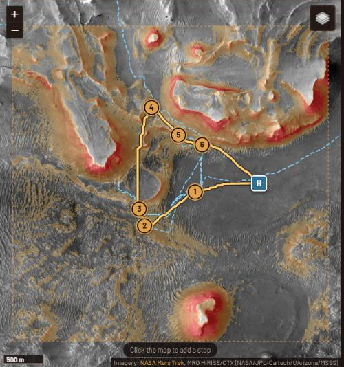

# Marswalk Budget

NASA Space Apps 2026 — *Interplanetary Survival Guide: Martian Map*.

Pick science stops on real terrain at Jezero or Gale Crater. Compare routes by walking time, suit oxygen, radiation dose and science value, then replan for dust, solar activity or a heavy sample kit. The console, field tablet and helmet HUD make the trade-off between exploration and getting home visible.



*Existing Jezero console capture. Imagery: NASA Mars Trek, MRO HiRISE/CTX; terrain: USGS / NASA. The current interface also includes route comparisons.*

## Run

From the repository root with **Node.js 20+**:

```bash
npm run serve
# Open http://localhost:8080/
```

No build step or install is needed to serve the committed data. `npm test` runs the offline test suite without `node_modules`. Browser CDN assets, Jezero imagery and rover photos need internet.

| Try it | URL |
|---|---|
| Synthetic demo | [Console](http://localhost:8080/) |
| Real sites | [Jezero](http://localhost:8080/?data=real) · [Gale](http://localhost:8080/?data=gale) |
| Route comparison | [Least oxygen](http://localhost:8080/?data=real&route=eco) · [safest terrain preference](http://localhost:8080/?data=real&route=safe) · [shortest](http://localhost:8080/?data=real&route=short) |
| Presenter tour | [Seven steps](http://localhost:8080/?data=real&tour=1); Right Arrow to advance |
| Field tablet | [Tablet](http://localhost:8080/tablet.html?data=real) |
| Helmet display | [HUD](http://localhost:8080/hud.html?data=gale&cond=real-gale) · [30-second playback](http://localhost:8080/hud.html?data=gale&cond=real-gale&play=30) |
| Split-eye helmet | [VR mode](http://localhost:8080/hud.html?data=real&vr=1) |

Use the console's view links to carry selected stops, hazards and route choice. VR also supports drag/arrow controls; phone compass and fullscreen depend on HTTPS, permissions and browser support. Physical Android/iOS checks await a preview.

## Model in five lines

1. A 5 m grid combines elevation, derived roughness and Jezero's thermal-inertia ground proxy.
2. Paths and visiting order account for terrain-dependent speed and metabolic energy; the slope limit is 20°.
3. Energy becomes metabolic oxygen demand; walking and stop time contribute to historical-baseline radiation dose.
4. Return costs mark the point of no return, a dust-storm contingency and the best set of stops within the search limits.
5. Least-oxygen, gentler-terrain “safest” and shortest routes use the same resource model.

[Model and assumptions](docs/model.md) · [source audit](docs/model-sources.md). This is an educational prototype: suit parameters and thresholds include team assumptions and Earth/lunar proxies. “Safest” is a terrain preference, and GO is a planning-model verdict.

## Data, AI and team

USGS / NASA elevation, NASA Mars Trek, THEMIS-derived Jezero thermal inertia, NASA/JPL rover positions and photos, CAB Spain's MEDA/REMS weather and NASA CCMC DONKI provide the context. [Full data links and credits](docs/submission/data.md) identify per-photo credits, licences and limits. Weather is archival; DONKI is a near-Earth proxy; Curiosity RAD was measured at Gale and is a proxy at Jezero. Gale has no sand layer. No MCD values were retrieved.

Anthropic Claude and OpenAI Codex assisted with implementation, tests, data preparation and drafts. [AI contribution disclosure](docs/submission/ai-disclosure.md). The human team owns the ideas, science decisions, story and submission.

Team: Louis, Tonny, Lewl and theamarz999-stack. [Roles](AGENTS.md) · [work log](STATUS.md) · [submission drafts](docs/submission/summary.md).
